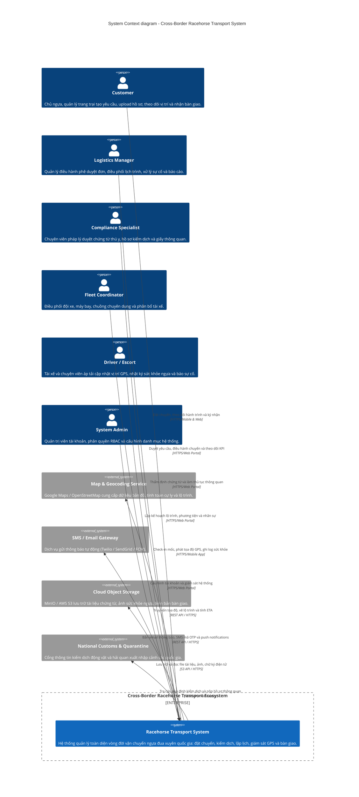
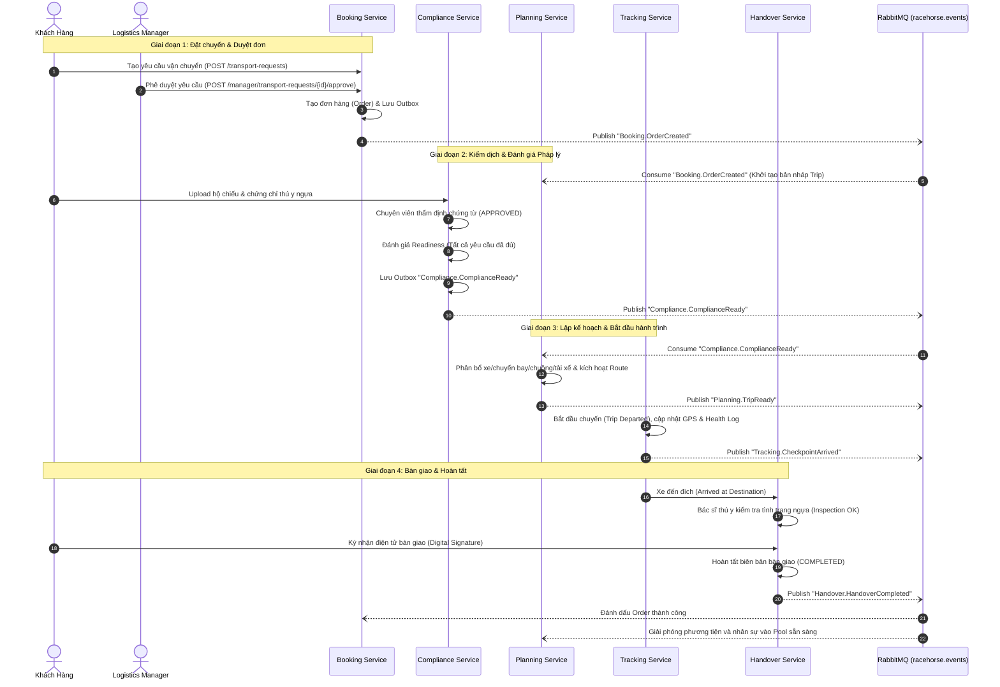
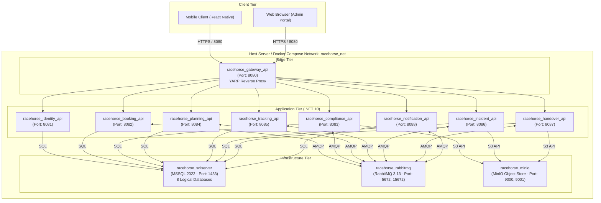

# Kiến Trúc Hệ Thống Vận Chuyển Ngựa Đua Xuyên Quốc Gia (C4 Model)

Tài liệu thiết kế kiến trúc hệ thống theo mô hình **C4 Model** (Simon Brown) cho bài Assignment môn **PRN232 - Cross-Border Racehorse Transport Management System**.

---

## 1. Cấp Độ 1: System Context Diagram (Biểu Đồ Ngữ Cảnh)

Mức độ trừu tượng cao nhất, thể hiện ranh giới hệ thống, các đối tượng tương tác (Actors) và các hệ thống bên ngoài (External Systems).



---

## 2. Cấp Độ 2: Container Diagram (Biểu Đồ Phân Rã Container & Microservices)

Biểu đồ mô tả chi tiết các ứng dụng, dịch vụ (Microservices), cơ sở dữ liệu riêng biệt (Database-per-Service) và cơ chế giao tiếp liên dịch vụ (HTTP Synchronous qua YARP Gateway và Asynchronous Event-Driven qua RabbitMQ).

```mermaid
C4Container
    title Container diagram - Cross-Border Racehorse Transport System

    Person(user, "User", "Customer, Manager, Specialist, Driver, Admin")

    System_Boundary(c1, "Racehorse Transport Microservices Platform") {
        Container(mobileApp, "Mobile Application", "React Native, Expo", "Ứng dụng di động cho Khách hàng theo dõi và Tài xế/Áp tải cập nhật GPS, sức khỏe ngựa.")
        Container(webApp, "Web Portal", "React / ASP.NET Blazor", "Cổng thông tin quản trị và điều hành cho Managers, Coordinators, Specialists.")
        
        Container(gateway, "API Gateway", "YARP, .NET 10", "Điểm truy cập duy nhất, định tuyến URL, kiểm tra xác thực JWT Bearer, cân bằng tải.")

        Container(identitySvc, "Identity Service", ".NET 10 Minimal API", "Quản lý User, Role, Authentication, phát hành JWT Access & Refresh Token.")
        ContainerDb(identityDb, "Identity DB", "SQL Server", "Lưu thông tin tài khoản, quyền hạn, token.")

        Container(bookingSvc, "Booking Service", ".NET 10 Minimal API", "Quản lý hồ sơ Khách hàng, Ngựa đua, Yêu cầu vận chuyển (Request) và Đơn hàng (Order).")
        ContainerDb(bookingDb, "Booking DB", "SQL Server", "Lưu Customer, Horse, TransportRequest, Order, Outbox.")

        Container(complianceSvc, "Compliance Service", ".NET 10 Minimal API", "Quản lý quy định kiểm dịch, thẩm định chứng từ, thủ tục thông quan và đánh giá Readiness.")
        ContainerDb(complianceDb, "Compliance DB", "SQL Server", "Lưu DocumentType, Document, RegulationRule, ClearanceCase, Outbox.")

        Container(planningSvc, "Planning Service", ".NET 10 Minimal API", "Lập kế hoạch chuyến đi (Trip), phiên bản lộ trình (Route Version), phân bổ xe/máy bay/chuồng/tài xế.")
        ContainerDb(planningDb, "Planning DB", "SQL Server", "Lưu Trip, RoutePlan, RouteLeg, Vehicle, Flight, Assignment, Outbox.")

        Container(trackingSvc, "Tracking Service", ".NET 10 Minimal API", "Thu thập tọa độ GPS, ghi nhận mốc hành trình (Milestone), tính toán ETA và nhật ký sức khỏe ngựa.")
        ContainerDb(trackingDb, "Tracking DB", "SQL Server", "Lưu TripEvent, LocationLog, HorseHealthLog, Outbox.")

        Container(incidentSvc, "Incident Service", ".NET 10 Minimal API", "Ghi nhận sự cố trên đường, đánh giá mức độ nghiêm trọng, kích hoạt đổi lộ trình khẩn cấp.")
        ContainerDb(incidentDb, "Incident DB", "SQL Server", "Lưu Incident, IncidentAction, InsuranceClaim, Outbox.")

        Container(handoverSvc, "Handover Service", ".NET 10 Minimal API", "Biên bản bàn giao đích, kiểm tra tình trạng ngựa, ghi nhận tranh chấp, ký nhận điện tử và chi phí.")
        ContainerDb(handoverDb, "Handover DB", "SQL Server", "Lưu HandoverRecord, InspectionItem, CostRevenue, Outbox.")

        Container(notificationSvc, "Notification Service", ".NET 10 Minimal API", "Lắng nghe sự kiện nghiệp vụ và phát thông báo Email/Push/SMS đa kênh.")
        ContainerDb(notificationDb, "Notification DB", "SQL Server", "Lưu NotificationLog, UserDeviceToken, Template.")

        Container_Queue(eventBus, "Message Broker", "RabbitMQ (Topic Exchange)", "Hàng đợi thông điệp tích hợp liên dịch vụ (`racehorse.events`), đảm bảo Eventual Consistency qua Outbox Pattern.")
        Container(objectStore, "Object Storage", "MinIO / S3", "Lưu trữ blob: file PDF hộ chiếu, kết quả xét nghiệm máu ngựa, ảnh hiện trường sự cố, chữ ký.")
    }

    System_Ext(mapExt, "Map / Geocoding API", "Google Maps / OpenStreetMap")
    System_Ext(smsExt, "SMS / Email Gateway", "Twilio / SendGrid")

    Rel(user, mobileApp, "Sử dụng", "HTTPS")
    Rel(user, webApp, "Sử dụng", "HTTPS")

    Rel(mobileApp, gateway, "Gọi API", "JSON / HTTPS + JWT")
    Rel(webApp, gateway, "Gọi API", "JSON / HTTPS + JWT")

    Rel(gateway, identitySvc, "Route /api/v1/auth/**", "HTTP/REST")
    Rel(gateway, bookingSvc, "Route /api/v1/customers, /horses, /transport-requests/**", "HTTP/REST")
    Rel(gateway, complianceSvc, "Route /api/v1/compliance/**", "HTTP/REST")
    Rel(gateway, planningSvc, "Route /api/v1/trips, /routes, /fleet/**", "HTTP/REST")
    Rel(gateway, trackingSvc, "Route /api/v1/tracking/**", "HTTP/REST")
    Rel(gateway, incidentSvc, "Route /api/v1/incidents/**", "HTTP/REST")
    Rel(gateway, handoverSvc, "Route /api/v1/handovers/**", "HTTP/REST")
    Rel(gateway, notificationSvc, "Route /api/v1/notifications/**", "HTTP/REST")

    Rel(identitySvc, identityDb, "Đọc/Ghi", "EF Core / SQL TCP 1433")
    Rel(bookingSvc, bookingDb, "Đọc/Ghi", "EF Core / SQL TCP 1433")
    Rel(complianceSvc, complianceDb, "Đọc/Ghi", "EF Core / SQL TCP 1433")
    Rel(planningSvc, planningDb, "Đọc/Ghi", "EF Core / SQL TCP 1433")
    Rel(trackingSvc, trackingDb, "Đọc/Ghi", "EF Core / SQL TCP 1433")
    Rel(incidentSvc, incidentDb, "Đọc/Ghi", "EF Core / SQL TCP 1433")
    Rel(handoverSvc, handoverDb, "Đọc/Ghi", "EF Core / SQL TCP 1433")
    Rel(notificationSvc, notificationDb, "Đọc/Ghi", "EF Core / SQL TCP 1433")

    Rel(bookingSvc, eventBus, "Publish: Booking.OrderCreated, RequestApproved", "AMQP / TCP 5672")
    Rel(complianceSvc, eventBus, "Publish: Compliance.ComplianceReady, ClearanceApproved", "AMQP / TCP 5672")
    Rel(planningSvc, eventBus, "Publish: Planning.TripReady, RouteActivated; Subscribe: OrderCreated, ComplianceReady", "AMQP / TCP 5672")
    Rel(trackingSvc, eventBus, "Publish: Tracking.TripDeparted, CheckpointArrived, HealthAlertRaised", "AMQP / TCP 5672")
    Rel(incidentSvc, eventBus, "Publish: Incident.IncidentCreated, RouteChangeRequested", "AMQP / TCP 5672")
    Rel(handoverSvc, eventBus, "Publish: Handover.HandoverCompleted", "AMQP / TCP 5672")
    Rel(notificationSvc, eventBus, "Subscribe tất cả sự kiện cần gửi thông báo", "AMQP / TCP 5672")

    Rel(complianceSvc, objectStore, "Upload/Download hồ sơ kiểm dịch, hộ chiếu", "S3 API / HTTP 9000")
    Rel(trackingSvc, mapExt, "Lấy lộ trình, tính ETA", "REST API / HTTPS")
    Rel(notificationSvc, smsExt, "Gửi email & SMS", "REST API / HTTPS")
```

---

## 3. Cấp Độ 3: Component Diagram (Chi Tiết Compliance Service - BE2)

Phân tích sâu cấu trúc nội tại của dịch vụ **Compliance Service** (được xây dựng theo mô hình Clean Architecture / Layered Architecture kết hợp Outbox Pattern).

```mermaid
C4Component
    title Component diagram - Compliance Service (.NET 10)

    Container(gatewayComp, "API Gateway", "YARP", "Chuyển tiếp HTTP requests")
    Container_Queue(busComp, "RabbitMQ", "Message Broker", "Topic Exchange racehorse.events")
    ContainerDb(dbComp, "Compliance DB", "SQL Server", "Cơ sở dữ liệu lưu trữ 9 bảng")
    Container(minioComp, "MinIO Object Storage", "S3 Compatible", "Lưu file chứng từ vật lý")

    Container_Boundary(complianceBoundary, "Compliance Service") {
        Component(apiEndpoints, "Minimal API Endpoints", "ASP.NET Core Minimal APIs", "Định nghĩa route: /document-types, /regulations, /documents, /clearance, /readiness/evaluate.")
        Component(authFilter, "JWT Auth Middleware", "ASP.NET Core Authentication", "Kiểm tra chữ ký số token, ClaimsPrincipal (UserId, Role).")

        Component(masterDataSvc, "Compliance Master Data Service", "C# Service", "CRUD danh mục loại giấy tờ (DocumentType) và quy tắc kiểm dịch theo tuyến quốc gia (RegulationRule).")
        Component(docSvc, "Document Service", "C# Service", "Xử lý nghiệp vụ tải lên, thẩm định phê duyệt/từ chối chứng từ thú y và xuất xứ ngựa.")
        Component(clearanceSvc, "Clearance Service", "C# Service", "Quản lý quy trình nộp và thẩm định hồ sơ hải quan/thông quan tại cửa khẩu, sân bay.")
        Component(readinessSvc, "Compliance Readiness Service", "C# Evaluation Engine", "Bộ máy kiểm tra tính hợp lệ toàn diện của hồ sơ chuyến đi và kích hoạt sự kiện ComplianceReady.")

        Component(dbContext, "ComplianceDbContext", "EF Core 10 DbContext", "Đơn vị làm việc (Unit of Work), ánh xạ ORM cho 9 bảng thực thể và bảng OutboxMessages.")
        Component(fileStore, "File Storage Service", "Local / S3 Storage Adapter", "Tải stream file lên bộ nhớ cục bộ hoặc S3 Bucket.")
        Component(outboxDispatcher, "Compliance Outbox Dispatcher", "IHostedService Background Worker", "Quét bảng Outbox định kỳ (5 giây), phát sự kiện lên RabbitMQ và đánh dấu PROCESSED.")
        Component(msgBus, "RabbitMQ Message Bus", "RabbitMQ.Client 7.x", "Quản lý channel, publish message bền vững (persistent) vào exchange racehorse.events.")
    }

    Rel(gatewayComp, authFilter, "Gửi request", "HTTP / REST")
    Rel(authFilter, apiEndpoints, "Chuyển tiếp sau xác thực", "In-Process")

    Rel(apiEndpoints, masterDataSvc, "Gọi xử lý danh mục", "C# Interface")
    Rel(apiEndpoints, docSvc, "Gọi nghiệp vụ tài liệu", "C# Interface")
    Rel(apiEndpoints, clearanceSvc, "Gọi nghiệp vụ thông quan", "C# Interface")
    Rel(apiEndpoints, readinessSvc, "Gọi đánh giá readiness", "C# Interface")

    Rel(docSvc, fileStore, "Lưu file đính kèm", "C# Stream")
    Rel(fileStore, minioComp, "Lưu file nhị phân", "S3 / HTTP")

    Rel(masterDataSvc, dbContext, "Truy vấn quy định", "EF Core")
    Rel(docSvc, dbContext, "Ghi nhận duyệt chứng từ & chèn Outbox", "EF Core")
    Rel(clearanceSvc, dbContext, "Cập nhật trạng thái thông quan & chèn Outbox", "EF Core")
    Rel(readinessSvc, dbContext, "Đọc rules, kiểm tra docs & chèn Outbox ComplianceReady", "EF Core")

    Rel(dbContext, dbComp, "Đọc / Ghi giao dịch", "SQL / TCP 1433")

    Rel(outboxDispatcher, dbContext, "Quét OutboxMessage trạng thái PENDING", "EF Core")
    Rel(outboxDispatcher, msgBus, "Đẩy sự kiện", "In-Process")
    Rel(msgBus, busComp, "Publish message qua exchange", "AMQP 0-9-1")
```

---

## 4. Cấp Độ 4: Dynamic & Sequence Flow (Quy Trình Nghiệp Vụ Chuẩn 6 Flow)

Biểu đồ trình tự thể hiện sự phối hợp bất đồng bộ giữa các Microservices qua RabbitMQ trong suốt vòng đời của một chuyến vận chuyển ngựa xuyên quốc gia:



---

## 5. Deployment Diagram (Mô Hình Triển Khai Docker)

Mô tả cấu trúc triển khai container thực tế theo tệp `docker-compose.yml`:



---

## 6. Bảng Tổng Hợp Trách Nhiệm Dịch Vụ (Bounded Contexts)

| Dịch vụ (Container) | Bounded Context | Trách nhiệm chính | Database | Event Chính Sinh Ra |
| :--- | :--- | :--- | :--- | :--- |
| **Identity Service** | User & Access | Đăng ký, đăng nhập, phân quyền RBAC, cấp phát JWT | `IdentityDb` | `UserCreated` |
| **Booking Service** | Commercial Booking | Hồ sơ chủ ngựa, thông tin ngựa, yêu cầu vận chuyển, tạo hợp đồng/đơn hàng | `BookingDb` | `Booking.RequestApproved`, `Booking.OrderCreated` |
| **Compliance Service** (BE2) | Legal & Quarantine | Danh mục giấy tờ, luật kiểm dịch các nước, duyệt chứng từ, thủ tục hải quan, đánh giá readiness | `ComplianceDb` | `Compliance.DocumentApproved`, `Compliance.ComplianceReady`, `Compliance.ClearanceApproved` |
| **Planning Service** | Logistics Planning | Quản lý đội xe, chuyến bay, chuồng chuyên dụng, lập phiên bản lộ trình, phân công tài xế | `PlanningDb` | `Planning.TripCreated`, `Planning.TripReady`, `Planning.RouteActivated` |
| **Tracking Service** | Realtime Execution | Check-in mốc hành trình, GPS định vị xe, ước lượng ETA, theo dõi mạch tim/nhiệt độ ngựa | `TrackingDb` | `Tracking.TripDeparted`, `Tracking.CheckpointArrived`, `Tracking.HealthAlertRaised` |
| **Incident Service** (BE2) | Emergency & Risk | Tiếp nhận sự cố trên đường, phân cấp độ rủi ro, đề xuất đổi tuyến tránh tắc biên/thời tiết xấu | `IncidentDb` | `Incident.IncidentCreated`, `Incident.EmergencyRouteChangeRequested` |
| **Handover Service** | Acceptance & Settlement | Kiểm tra bàn giao tại đích, ký nhận điện tử, ghi nhận tranh chấp, chốt chi phí/doanh thu chuyến | `HandoverDb` | `Handover.HandoverCompleted` |
| **Notification Service** (BE2) | Communication | Gửi Email, SMS, Webhook, Push Notification theo dõi đơn và sự cố theo thời gian thực | `NotificationDb` | `Notification.Dispatched` |
| **API Gateway** | Edge Routing | Cổng YARP reverse proxy tập trung, kiểm tra JWT, Rate limiting, che giấu địa chỉ nội bộ | N/A | N/A |
